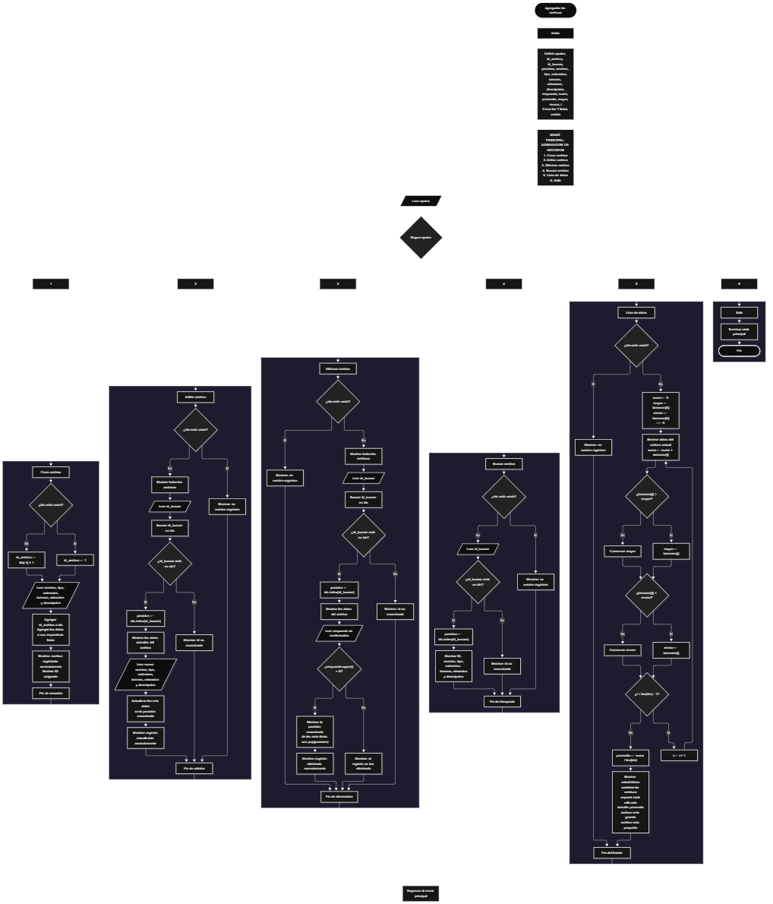

 

Este proyecto, llamado <b>agregador de archivos</b>, fue desarrollado en <b>python</b> como un ejercicio práctico para fortalecer la lógica de programación mediante la creación de un sistema de gestión de archivos desde la consola. El programa cuenta con un menú principal de seis opciones que permite <b>crear, editar, eliminar, buscar y listar</b> registros de archivos, además de consultar estadísticas sobre sus tamaños. Cada registro almacena datos como el nombre, tipo, extensión, tamaño en megabytes, ubicación y descripción, utilizando siete listas paralelas para organizar la información durante la ejecución. Durante su desarrollo se aplicaron conceptos fundamentales de programación, como variables, listas, estructuras condicionales, ciclos repetitivos, estructuras de selección y operaciones para buscar, modificar y eliminar registros. También se incorporaron cálculos estadísticos para determinar la cantidad de archivos, el espacio total utilizado, el tamaño promedio y los tamaños máximo y mínimo. Este proyecto permite poner en práctica los conocimientos adquiridos en Python y sirve como base para desarrollar sistemas de gestión más avanzados utilizando otros lenguajes y tecnologías.

<h2 align="center">⚙️ Funcionamiento del menú principal</h2>

### ➕ Crear archivo

La opción <b>1) crear archivo</b> permite registrar un nuevo archivo en el sistema. Antes de realizar el registro, el programa comprueba si la lista <b>ids</b> está vacía mediante la condición <b>len(ids) == 0</b>. Si no existen registros, asigna el identificador <b>1</b> al nuevo archivo. En caso contrario, obtiene el último identificador almacenado y le suma uno mediante la expresión <b>ids[-1] + 1</b>. Después, solicita el <b>nombre, tipo, extensión, tamaño en mb, ubicación y descripción</b> del archivo. El tamaño se convierte a un número decimal mediante la función <b>float()</b>. Una vez introducidos los datos, el programa utiliza el método <b>append()</b> para agregar el identificador y la información correspondiente a sus siete listas paralelas. Finalmente, muestra los mensajes <b>"archivo registrado correctamente."</b> y <b>"id:"</b>, seguido del identificador asignado. El programa no establece una capacidad máxima explícita para los registros, aunque la información solo se conserva durante la ejecución.

### ✏️ Editar archivo

La opción <b>2) editar archivo</b> permite modificar la información de un archivo registrado. Primero, el programa comprueba si la lista <b>ids</b> está vacía. Si no existen registros, muestra el mensaje <b>"no existen registros."</b>. En caso contrario, presenta una lista con los identificadores, nombres, tipos, extensiones, tamaños, ubicaciones y descripciones de los archivos almacenados. Después, solicita el identificador del registro que se desea editar y convierte el valor introducido a un número entero mediante <b>int()</b>. El programa comprueba si el identificador existe en la lista <b>ids</b> utilizando la condición <b>id_buscar in ids</b>. Si lo encuentra, obtiene su posición mediante <b>ids.index(id_buscar)</b>, muestra los datos actuales y solicita el nuevo nombre, tipo, extensión, tamaño, ubicación y descripción. El tamaño se convierte nuevamente mediante <b>float()</b>, y los nuevos valores se almacenan en las posiciones correspondientes de las listas, conservando el identificador original. Finalmente, muestra el mensaje <b>"registro actualizado correctamente."</b>. Si el identificador no existe, presenta el mensaje <b>"id no encontrada."</b>.

### 🗑️ Eliminar archivo

La opción <b>3) eliminar archivo</b> permite eliminar un registro mediante su identificador. Primero, comprueba si existen archivos almacenados en la lista <b>ids</b>. Si no hay registros, muestra el mensaje <b>"no existen registros."</b>. Si existen archivos, presenta una lista con los datos de cada registro y solicita el identificador que se desea eliminar. El valor introducido se convierte a entero mediante <b>int()</b> y se comprueba su existencia con la condición <b>id_buscar in ids</b>. Si el identificador es válido, el programa obtiene la posición mediante <b>ids.index(id_buscar)</b> y muestra todos los datos del archivo seleccionado. A continuación, solicita confirmación mediante la pregunta <b>"¿desea eliminar este registro? (s/n):"</b>. Si la respuesta, convertida a mayúsculas con <b>upper()</b>, es igual a <b>"S"</b>, elimina la misma posición de las siete listas utilizando el método <b>pop()</b>. De esta manera, los datos restantes conservan la correspondencia entre sus posiciones. Finalmente, muestra el mensaje <b>"registro eliminado correctamente."</b>. Si el usuario introduce cualquier respuesta distinta de <b>"s"</b> o <b>"S"</b>, presenta el mensaje <b>"el registro no fue eliminado."</b>. Si el identificador no existe, muestra <b>"id no encontrada."</b>.

### 🔎 Buscar archivo

La opción <b>4) buscar archivo</b> permite localizar un archivo registrado mediante su identificador. Primero, el programa comprueba si la lista <b>ids</b> está vacía. Si no existen registros, muestra el mensaje <b>"no existen registros."</b>. En caso contrario, solicita el identificador del archivo y convierte el valor introducido mediante <b>int()</b>. Después, utiliza la condición <b>id_buscar in ids</b> para comprobar si el registro existe. Cuando encuentra el identificador, obtiene su posición mediante <b>ids.index(id_buscar)</b> y muestra la información completa del archivo: identificador, nombre, tipo, extensión, tamaño en megabytes, ubicación y descripción. Si el identificador no aparece en la lista, presenta el mensaje <b>"id no encontrada."</b>. Esta función permite consultar un registro específico sin necesidad de mostrar todos los archivos almacenados.

### 📋 Lista de datos y estadísticas

La opción <b>5) lista de datos</b> permite visualizar todos los archivos registrados y calcular estadísticas relacionadas con sus tamaños. Primero, el programa comprueba si la lista <b>ids</b> está vacía. Si no existen registros, muestra el mensaje <b>"no existen registros."</b>. En caso contrario, inicializa la variable <b>suma</b> con el valor <b>0</b> y establece las variables <b>mayor</b> y <b>menor</b> con el tamaño del primer archivo almacenado, utilizando <b>tamanos[0]</b>. Después, recorre los registros mediante un ciclo <b>for</b> y muestra los datos completos de cada archivo. Durante el recorrido, acumula los tamaños en la variable <b>suma</b> mediante la operación <b>suma += tamanos[i]</b>. También compara cada tamaño con las variables <b>mayor</b> y <b>menor</b> para identificar el archivo de mayor y menor tamaño. Una vez finalizado el recorrido, calcula el promedio mediante la expresión <b>suma / len(ids)</b>. Finalmente, muestra la cantidad de archivos, el espacio total utilizado, el tamaño promedio, el archivo más grande y el archivo más pequeño. Los resultados de los tamaños se presentan redondeados a dos decimales mediante <b>round(valor, 2)</b>.

### 🚪 Salir del menú principal

La opción <b>6) salir</b> permite finalizar la ejecución del programa. Cuando el usuario selecciona esta opción, el sistema muestra el mensaje <b>"gracias por utilizar el agregador de archivos."</b> y ejecuta la instrucción <b>break</b>, que interrumpe el ciclo <b>while True</b>. De esta manera, el programa termina sin volver a mostrar el menú principal. Los registros almacenados durante la ejecución no se guardan permanentemente, por lo que se pierden al finalizar el programa.

<h2 align="center">🧠 Temas aplicados en el proyecto</h2>

### 📦 Variables

En este proyecto se utilizan variables para almacenar temporalmente los datos introducidos por el usuario, controlar la opción seleccionada en el menú, identificar la posición de los registros y realizar los cálculos estadísticos. Cada variable cumple una función específica dentro de las operaciones de gestión de archivos.

🔢 **Opcion:** Almacena la opción seleccionada por el usuario en el menú principal.

🆔 **Id_archivo:** Almacena el identificador que se asigna al nuevo registro.

🔎 **Id_buscar:** Guarda el identificador introducido por el usuario para editar, eliminar o buscar un archivo.

📍 **Posicion:** Almacena la posición del registro encontrado en la lista de identificadores.

📄 **Nombre, tipo, extension, tamano, ubicacion y descripcion:** Almacenan temporalmente los datos introducidos al crear o editar un archivo.

📊 **Suma:** Acumula los tamaños de todos los archivos para calcular el espacio total utilizado.

📈 **Promedio:** Almacena el tamaño promedio de los archivos registrados.

⬆️ **Mayor:** Conserva el tamaño más grande encontrado durante el recorrido de los registros.

⬇️ **Menor:** Conserva el tamaño más pequeño encontrado durante el recorrido de los registros.

🔄 **I:** Funciona como contador en los ciclos <b>for</b> y permite recorrer las posiciones de las listas.

### 🗃️ Listas paralelas

En este proyecto se utilizan siete listas relacionadas para almacenar la información de cada archivo. Todas las listas utilizan la misma posición para representar un mismo registro. Por ejemplo, los datos del archivo ubicado en la posición <b>0</b> se encuentran distribuidos entre <b>ids[0], nombres[0], tipos[0], extensiones[0], tamanos[0], ubicaciones[0] y descripciones[0]</b>. Esta organización permite recorrer, buscar, modificar, mostrar y eliminar registros manteniendo la correspondencia entre sus datos.

🆔 **Ids:** Almacena los identificadores de los archivos registrados.

📝 **Nombres:** Almacena los nombres de los archivos.

📂 **Tipos:** Almacena los tipos de archivo.

🔤 **Extensiones:** Almacena las extensiones de los archivos.

📏 **Tamanos:** Almacena los tamaños de los archivos en megabytes.

📍 **Ubicaciones:** Almacena las ubicaciones de los archivos.

📄 **Descripciones:** Almacena las descripciones de los archivos registrados.

### 🔀 Estructuras condicionales

En este proyecto se utilizan las estructuras <b>if</b>, <b>elif</b> y <b>else</b> para controlar las opciones del menú y determinar qué operación debe ejecutarse. También se utilizan para comprobar si existen registros, verificar si un identificador se encuentra en la lista, decidir si un archivo debe eliminarse y comparar los tamaños para identificar los valores mayor y menor. Estas condiciones permiten que el programa responda de manera diferente según la información almacenada y las decisiones del usuario.

### 🔄 Estructuras repetitivas

En este proyecto se utilizan los ciclos <b>while</b> y <b>for</b>. El ciclo <b>while True</b> mantiene activo el menú principal y permite ejecutar las operaciones de gestión hasta que el usuario selecciona la opción de salida. Los ciclos <b>for</b> permiten recorrer las listas para mostrar los registros durante la edición y eliminación, así como para listar los archivos y calcular las estadísticas de sus tamaños. Estos ciclos facilitan la ejecución repetitiva de instrucciones sin tener que escribirlas individualmente para cada registro.

### 🎯 Selección mediante if, elif y else

El programa evalúa el valor almacenado en la variable <b>opcion</b> y ejecuta el bloque de instrucciones correspondiente. Cada condición representa una operación del sistema: <b>crear, editar, eliminar, buscar, listar datos o salir</b>. También se utiliza el bloque <b>else</b> para mostrar el mensaje <b>"opción no válida."</b> cuando el usuario introduce una opción que no coincide con las definidas en el menú principal.

### 🔍 Búsqueda de registros

La búsqueda de registros se realiza mediante los operadores <b>in</b> y el método <b>index()</b>. Primero, el programa comprueba si el identificador introducido está presente en la lista <b>ids</b>. Si existe, utiliza <b>ids.index(id_buscar)</b> para obtener la posición del registro. Esa posición se utiliza para consultar o modificar los datos correspondientes en las demás listas. Si el identificador no existe, el programa muestra el mensaje <b>"id no encontrada."</b>. Este procedimiento se utiliza en las operaciones de edición, eliminación y búsqueda de archivos.

### 🧰 Métodos de listas

El proyecto utiliza diferentes operaciones de listas para administrar los registros. El método <b>append()</b> agrega nuevos elementos al final de las listas; el método <b>pop()</b> elimina el elemento ubicado en una posición determinada; y el método <b>index()</b> permite obtener la posición de un identificador. Además, se utiliza la expresión <b>ids[-1]</b> para acceder al último identificador registrado y la función <b>len()</b> para comprobar si existen datos y determinar la cantidad de archivos almacenados.

### 🔢 Conversión y redondeo de valores

El programa utiliza la función <b>int()</b> para convertir el identificador introducido por el usuario en un número entero y la función <b>float()</b> para convertir el tamaño del archivo en un número decimal. Para presentar las estadísticas, emplea <b>round()</b>, que permite redondear el espacio total, el tamaño promedio y los tamaños máximo y mínimo a dos decimales. Estas funciones facilitan el manejo de valores numéricos durante las operaciones del sistema.

### 📊 Cálculos estadísticos

El módulo de estadísticas utiliza acumuladores, comparaciones y operaciones aritméticas para analizar los tamaños de los archivos registrados. La variable <b>suma</b> acumula todos los tamaños, mientras que <b>mayor</b> y <b>menor</b> permiten identificar los valores extremos. Finalmente, la variable <b>promedio</b> almacena el resultado de dividir la suma de los tamaños entre la cantidad de archivos. Estos cálculos permiten conocer el espacio total utilizado y obtener una visión general de los tamaños de los archivos almacenados.

<h2 align="center">¿Cómo se implementaron las operaciones crud en el proyecto?</h2>

Las operaciones <b>crud</b> se implementaron mediante las opciones del menú principal, permitiendo administrar los registros de archivos. La operación <b>crear</b> corresponde a <b>crear archivo</b>, donde se introducen los datos de un nuevo registro; <b>leer</b> se realiza mediante las opciones <b>buscar archivo</b> y <b>lista de datos</b>, que permiten consultar un registro específico o visualizar todos los registros; <b>actualizar</b> corresponde a <b>editar archivo</b>, donde se modifican los datos de un archivo registrado; y <b>eliminar</b> se realiza mediante la opción <b>eliminar archivo</b>, que solicita confirmación antes de borrar la información. Estas operaciones utilizan listas, variables, condicionales y ciclos para gestionar los datos almacenados temporalmente durante la ejecución del programa.

<h2 align="center">Diagrama de flujo del proyecto</h2>

<h2 align="center">🛡️ Validaciones del programa</h2>

### 📭 No existen registros

Esta comprobación se utiliza en las opciones de <b>editar, eliminar, buscar y lista de datos</b>. El programa comprueba si la lista <b>ids</b> está vacía mediante la condición <b>len(ids) == 0</b>. Si no existen archivos registrados, muestra el mensaje <b>"no existen registros."</b> y evita continuar con las operaciones que necesitan información almacenada. Esta comprobación permite informar al usuario cuando todavía no hay registros disponibles.

### ❌ Identificador no encontrado

Esta comprobación se utiliza durante las operaciones de <b>editar, eliminar y buscar archivo</b>. El programa verifica si el identificador introducido se encuentra en la lista <b>ids</b> mediante la condición <b>id_buscar in ids</b>. Si el identificador existe, obtiene la posición del registro mediante <b>ids.index(id_buscar)</b> y continúa con la operación seleccionada. Si no lo encuentra, muestra el mensaje <b>"id no encontrada."</b>.

### ❓ Confirmación de eliminación

Antes de eliminar un archivo, el programa muestra sus datos y solicita confirmación mediante una respuesta de texto. La condición <b>respuesta.upper() == "S"</b> permite aceptar tanto la letra minúscula como la mayúscula. Si la respuesta es <b>"s"</b> o <b>"S"</b>, se eliminan los datos de la posición seleccionada en las siete listas. Cualquier otra respuesta cancela la operación y muestra el mensaje <b>"el registro no fue eliminado."</b>.

### ⚠️ Opción no válida

La estructura condicional del menú incluye un bloque <b>else</b> que muestra el mensaje <b>"opción no válida."</b> cuando el usuario introduce un valor distinto de las opciones disponibles. Esta comprobación informa al usuario de que debe seleccionar una opción válida para continuar utilizando el sistema.

### 🔢 Conversión de datos numéricos

El programa convierte los identificadores introducidos mediante <b>int()</b> y los tamaños de archivo mediante <b>float()</b>. Sin embargo, no utiliza bloques <b>try/except</b> para controlar errores de conversión. Si el usuario introduce texto no numérico en estos campos, el programa puede generar una excepción y detener la ejecución. Tampoco comprueba que el tamaño sea positivo ni valida otros campos como el nombre, la extensión o la ubicación.

### 🆔 Generación de identificadores

El identificador se genera comprobando si la lista <b>ids</b> está vacía. Si no existen registros, el nuevo archivo recibe el ID <b>1</b>. Si existen registros, se toma el último identificador almacenado y se incrementa en uno. Debido a que el sistema no utiliza un contador independiente ni calcula el identificador máximo existente, si se elimina el último registro, el siguiente archivo creado podría recibir nuevamente un identificador que ya había sido utilizado anteriormente.

### 💾 Almacenamiento temporal

Los datos se almacenan en listas de Python que permanecen disponibles mientras el programa está en ejecución. El código no implementa archivos externos, bases de datos ni mecanismos de persistencia. Por esta razón, al cerrar el programa, la información registrada se pierde y debe introducirse nuevamente en la siguiente ejecución.

<h2 align="center">🎯 Objetivo del proyecto</h2>

El objetivo principal de este proyecto es fortalecer la <b>lógica de programación</b> mediante el desarrollo de un sistema de gestión de archivos en <b>python</b>. A través de su construcción se busca aplicar conocimientos sobre variables, listas, estructuras condicionales, ciclos repetitivos, selección de opciones y operaciones CRUD, integrándolos para resolver un problema de manera organizada. Además, el proyecto permite practicar cálculos estadísticos con datos numéricos y comprender cómo registrar, consultar, modificar y eliminar información en una aplicación de consola. De esta manera, establece una base para desarrollar sistemas de gestión más completos que incorporen almacenamiento permanente, validaciones adicionales y nuevas funcionalidades.

